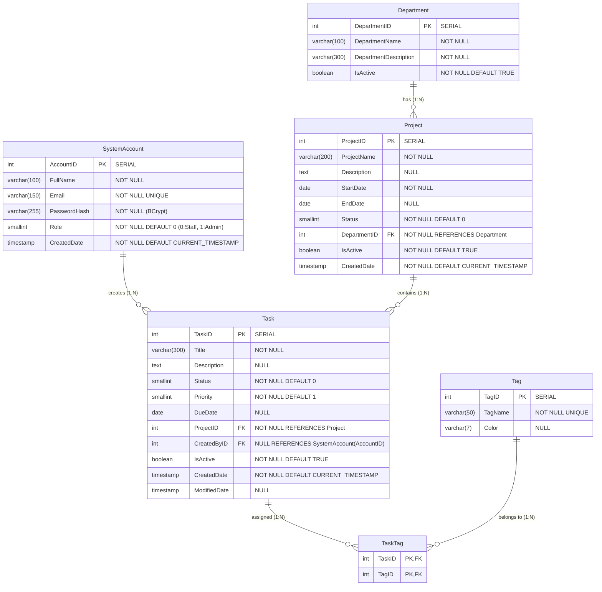

# TaskTrack — Task & Team Management System (Assignment 2)

[](https://github.com/longfptaka3011/Assignment_2_PRN232_FA26/actions/workflows/ci.yml)
[](https://dotnet.microsoft.com/)
[](https://react.dev/)
[](https://www.typescriptlang.org/)
[](https://www.postgresql.org/)
[](https://vitejs.dev/)
[](https://render.com/)
[](https://vercel.com/)

> **PRN232 — Advanced Cross-Platform Application Programming with .NET (Assignment 2)**  
> **Student ID**: `QE190010` | **Author**: `Trần Nguyễn Bảo Long` (`longfptaka3011`)  
> **Repository**: [https://github.com/longfptaka3011/Assignment_2_PRN232_FA26](https://github.com/longfptaka3011/Assignment_2_PRN232_FA26)

---

## 🔑 Test Credentials (For Grading Verification)

Both test accounts are fully active, seeded, and verified in the live PostgreSQL database.

| Account Type | Email Address | Password | Role / Access Privileges |
| :--- | :--- | :--- | :--- |
| 🛡️ **Admin Account** | `admin@tasktrack.com` | `AdminPassword@123` | **Role 1 (Admin)** — Full access to `/admin/accounts`, role elevations, and all CRUD endpoints |
| 👤 **Staff Account** | `staff@tasktrack.com` | `StaffPassword@123` | **Role 0 (Staff)** — Authenticated write access to departments, projects, tasks, tags. Forbidden (403) from accounts |

> **Note**: The **Admin account** was seeded directly into the Supabase PostgreSQL database with pre-hashed BCrypt salt. The **Staff account** was registered via the public `POST /api/auth/register` endpoint.

---

## 🌐 Live Production Links

| Resource | URL | Description |
| :--- | :--- | :--- |
| 🚀 **Web Application (Frontend)** | [https://assignment-1-prn-232-fa-26.vercel.app](https://assignment-1-prn-232-fa-26.vercel.app) | React 19 SPA with JWT Auth & Protected Management deployed on Vercel |
| ⚡ **RESTful API Service** | [https://assignment-1-prn232-fa26.onrender.com](https://assignment-1-prn232-fa26.onrender.com) | ASP.NET Core 10 Web API hosted on Render Docker container |
| 📖 **Swagger / OpenAPI UI** | [https://assignment-1-prn232-fa26.onrender.com/swagger](https://assignment-1-prn232-fa26.onrender.com/swagger) | Interactive API exploration with JWT Bearer Authorize support |
| 🐙 **GitHub Repository** | [https://github.com/longfptaka3011/Assignment_2_PRN232_FA26](https://github.com/longfptaka3011/Assignment_2_PRN232_FA26) | Full-stack monorepo with automated GitHub Actions CI |

---

## 📌 Assignment 2 Feature Summary

1. **User Authentication & Authorization**:
   - `assignment1.SystemAccount` table storing `AccountID`, `FullName`, `Email` (unique), `PasswordHash` (BCrypt), `Role` (0=Staff, 1=Admin), `CreatedDate`.
   - Passwords hashed using **BCrypt** with automatic work-factor salt before database persistence.
   - JWT Token authentication issued with 24-hour expiration, containing `AccountID`, `Email`, `Role`, and security claims.
   - Secret key configured via `JWT_SECRET` environment variable (Render in Production, fallback in Dev).
2. **Endpoint Access Control Matrix**:
   - **Public (No token required)**: All GET operations from Assignment 1 remain public (Departments, Projects, Tasks, Tags, Search).
   - **Authenticated (Any logged-in user - Staff or Admin)**: POST, PUT, DELETE on Departments, Projects, Tasks, and Tags.
   - **Admin Only (Role = 1)**: All `/api/accounts` endpoints (List all, Get by ID, Update role/name, Delete).
   - **Rejection Policies**:
     - Unauthenticated requests to protected endpoints return **HTTP 401 Unauthorized**.
     - Staff accounts attempting Admin endpoints return **HTTP 403 Forbidden**.
     - Account deletion is strictly rejected (**HTTP 400**) if the account has created any tasks.
3. **Frontend Authentication & Protected Management**:
   - `/login`: Form with email/password validation, clear error messages, and 1-click test credentials fill for evaluators.
   - `/register`: Staff registration form with client-side required field, email format, and password confirmation checks.
   - `/admin`: Protected Admin Dashboard featuring statistical summary cards and module quick-links.
   - `/admin/departments`, `/admin/projects`, `/admin/tasks`, `/admin/tags`: Protected management views with modal dialogs and confirmation modals.
   - `/admin/accounts`: Admin-only account management table to inspect users, alter roles, and delete accounts.
   - Session Handling:
     - Navigation bar dynamically reflects authentication state.
     - Axios interceptor attaches `Authorization: Bearer <token>` on all requests.
     - Automatic session expiration detection with immediate redirection to `/login` on HTTP 401.

---

## 📊 Updated Database Schema & ERD



---

## 🛡️ API Endpoints Summary

### Authentication Endpoints (Public)
| Method | Endpoint | Description | Auth Required |
| :--- | :--- | :--- | :---: |
| `POST` | `/api/auth/register` | Register new Staff account (returns 201 or 409) | ❌ Public |
| `POST` | `/api/auth/login` | Authenticate email + password & return JWT | ❌ Public |
| `GET` | `/api/auth/me` | Fetch active user profile information | 🔒 Authenticated |

### Account Management Endpoints (Admin Only)
| Method | Endpoint | Description | Auth Required |
| :--- | :--- | :--- | :---: |
| `GET` | `/api/accounts` | List all system accounts with task metrics | 👑 Admin Only |
| `GET` | `/api/accounts/{id}` | Get one account by ID | 👑 Admin Only |
| `PUT` | `/api/accounts/{id}` | Update account full name or role | 👑 Admin Only |
| `DELETE` | `/api/accounts/{id}` | Delete account (rejected if account has tasks) | 👑 Admin Only |

### Resource Management Endpoints
| Resource | GET (List & Details) | POST (Create) | PUT (Update) | DELETE |
| :--- | :---: | :---: | :---: | :---: |
| **Departments** | ❌ Public | 🔒 Authenticated | 🔒 Authenticated | 🔒 Authenticated |
| **Projects** | ❌ Public | 🔒 Authenticated | 🔒 Authenticated | 🔒 Authenticated |
| **Tasks** | ❌ Public | 🔒 Authenticated (saves `CreatedByID`) | 🔒 Authenticated | 🔒 Authenticated (soft-delete) |
| **Tags** | ❌ Public | 🔒 Authenticated | 🔒 Authenticated | 🔒 Authenticated |

---

## 🚀 Running Locally

### Backend (.NET 10 API)
```bash
cd QE190010_PRN232_Ass1_BE
dotnet restore
dotnet run --project TaskTrack.API/TaskTrack.API.csproj
```
API available at `http://localhost:5000` with Swagger at `http://localhost:5000/swagger`.

### Frontend (React 19 Vite)
```bash
cd QE190010_PRN232_Ass1_FE
npm install
npm run dev
```
Application available at `http://localhost:5173`.
